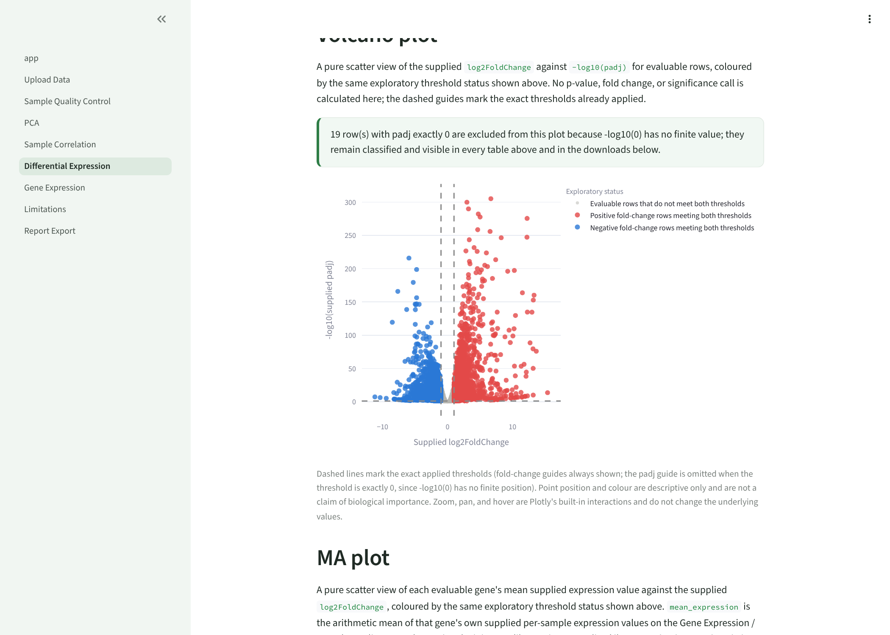
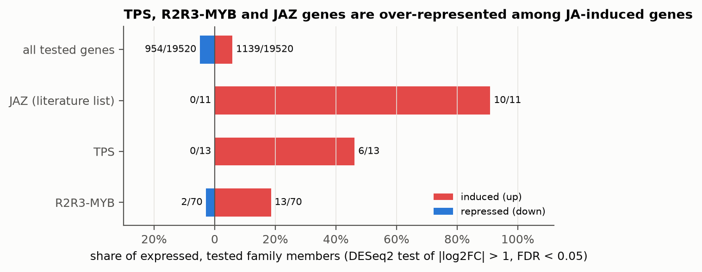

# Plant Expression Explorer

[](https://github.com/jikaojiangbio-source/plant-expression-explorer-app/actions/workflows/tests.yml)

A Streamlit application for exploring **already preprocessed** plant RNA-seq
results (a normalised expression matrix, sample metadata and, optionally, a
precomputed differential-expression table), plus a fully reproducible
**real-data case study** showing the analysis that produces such tables.

The app is deliberately descriptive: it validates and visualises what you give
it, and it never fits a statistical model itself. Model fitting lives in a
separate, scripted analysis (`analysis/`) so that every number has a
traceable, rerunnable origin.



## Real-data case study: jasmonate response in tomato hairy roots

[`analysis/tomato_ja_hairy_roots/`](analysis/tomato_ja_hairy_roots/README.md)
re-analyses public RNA-seq of tomato hairy roots treated with jasmonate (JA)
or mock (Expression Atlas E-MTAB-11876, three biological replicates each) and
asks which **terpene synthase (TPS)** and **R2R3-MYB** genes respond.

* pyDESeq2 differential expression with a threshold test (\|log2FC\| > 1,
  FDR < 0.05): 1,139 induced and 954 repressed genes of 19,522 tested.
* Positive control: 10 of the 11 expressed literature JAZ genes are induced.
* Gene families called reproducibly from Pfam domains (pyhmmer): JA-induced
  genes are over-represented among expressed TPS (6 of 13) and R2R3-MYB
  (13 of 70) genes.
* Cross-checked against Expression Atlas's independent DESeq2 analysis of the
  same counts: log2 fold-change Pearson r = 0.9998.
* One command reproduces every output byte for byte; inputs are
  checksum-recorded.



The full report, with methods, limitations and a "redo it yourself" checklist,
is in [`analysis/tomato_ja_hairy_roots/README.md`](analysis/tomato_ja_hairy_roots/README.md).

## Quick start

Python 3.13.9 is the pinned acceptance version.

```bash
python3.13 -m venv .venv
source .venv/bin/activate
python -m pip install -r requirements.txt
streamlit run app.py
```

Then open **Upload Data** and choose one of:

| Tab | What it loads |
|---|---|
| Use demo data | 120 synthetic genes; for learning the interface only |
| Real case study | the tomato jasmonate case study above (19,522 genes, 6 samples) |
| Upload my own data | your own CSV files (templates are downloadable on the page) |

For the case study, upload
`data/case_studies/tomato_ja_hairy_roots/gene_annotation.csv` on the
**Gene Expression** page to see TPS, MYB and JAZ family labels next to gene IDs.

## What the app does

| Page | Purpose |
|---|---|
| Upload Data | validate the three CSV inputs, with actionable error messages; record dataset context |
| Sample Quality Control | per-sample distribution summaries; missing values disclosed, never imputed |
| PCA | mean-centred sample PCA, optional unit-variance scaling |
| Sample Correlation | Pearson or Spearman sample correlation heatmap |
| Differential Expression | threshold exploration, volcano and MA plots of the supplied results |
| Gene Expression | single- and multi-gene lookup, optional annotation and time axis |
| Limitations | what the app can and cannot support |
| Report Export | one PDF of the current tables, with SHA-256 checksums of the inputs |

Every analysis page also offers deterministic UTF-8 CSV downloads of its
current result tables. Input format, validation rules and per-page details
are in
[`docs/USER_GUIDE.md`](docs/USER_GUIDE.md).

## Scientific boundaries

* The **application** never processes FASTQ files, normalises raw counts,
  corrects batch effects or fits a differential-expression model. It shows
  supplied values and simple descriptive summaries of them.
* The **analysis workspace** (`analysis/`) is where models are fitted. It runs
  offline, is pinned in its own `requirements.txt`, and writes app-ready tables
  to `data/case_studies/` together with full provenance.
* Thresholds on the Differential Expression page are for exploration. A claim
  that a gene "responds" should come from a test that includes the effect-size
  threshold, as the case study does, not from filtering afterwards.

## Repository layout

```text
app.py, pages/                   Streamlit pages (presentation only)
plant_expression_explorer/       validation, loading and descriptive logic (no Streamlit)
analysis/tomato_ja_hairy_roots/  reproducible case-study analysis, report, figures, results
data/demo/                       synthetic demo tables
data/case_studies/               app-ready tables written by analysis/ scripts
data/annotations/                small hand-verified species gene references
docs/                            user guide, development history, screenshots
tests/                           pytest suite (app, data contracts, analysis helpers)
```

## Tests

```bash
python -m pytest
```

The suite (over 800 tests) runs in CI on every push and pull request. It
includes data-contract tests that load the bundled case study through the
app's own validation, a positive-control check that the literature JAZ genes
are induced, and unit tests for every analysis helper. The case-study
pipeline itself needs the analysis environment:

```bash
python -m pip install -r analysis/tomato_ja_hairy_roots/requirements.txt
python analysis/tomato_ja_hairy_roots/run_case_study.py
```

## How this project was built (AI assistance)

This project is developed with AI coding assistants, and that is stated here
rather than hidden.

* Phases 1 to 12 of the application were developed with an AI coding agent
  working from the instructions in [`AGENTS.md`](AGENTS.md) (the merged branch
  name `codex/...` records that this was OpenAI Codex).
* The real-data case study (`analysis/`, `data/case_studies/`, the
  case-study app integration and its tests), the status-plot colour fix and
  this documentation restructure were drafted with Claude (Anthropic) in
  November 2026.
* The author, Jikao Jiang, set the scope and scientific questions, reviews the
  work, and re-implements the case study independently as a learning
  exercise; the case-study README ends with the checkpoints used for that.

Every analytical choice is written down with its reason so it can be checked
rather than trusted. Please report errors as GitHub issues.

## Licence

MIT, see [`LICENSE`](LICENSE). Public data used in the case study remain
under their original terms (EMBL-EBI Expression Atlas, Ensembl Plants,
InterPro/Pfam); see the case-study README for sources and citations.

## Further reading

* [`docs/USER_GUIDE.md`](docs/USER_GUIDE.md): input contracts, validation, every page in detail
* [`docs/CHANGELOG.md`](docs/CHANGELOG.md): development history, phase by phase
* [`CONTRIBUTING.md`](CONTRIBUTING.md): development setup and scientific boundaries
