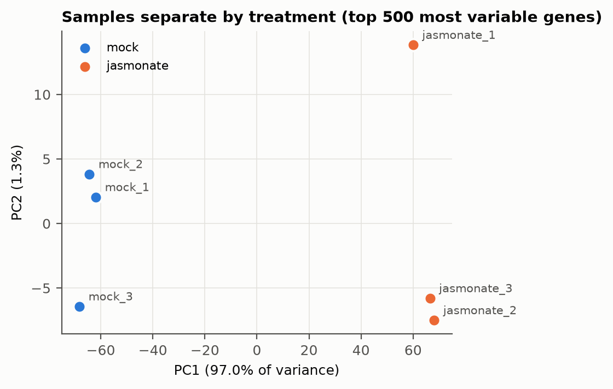
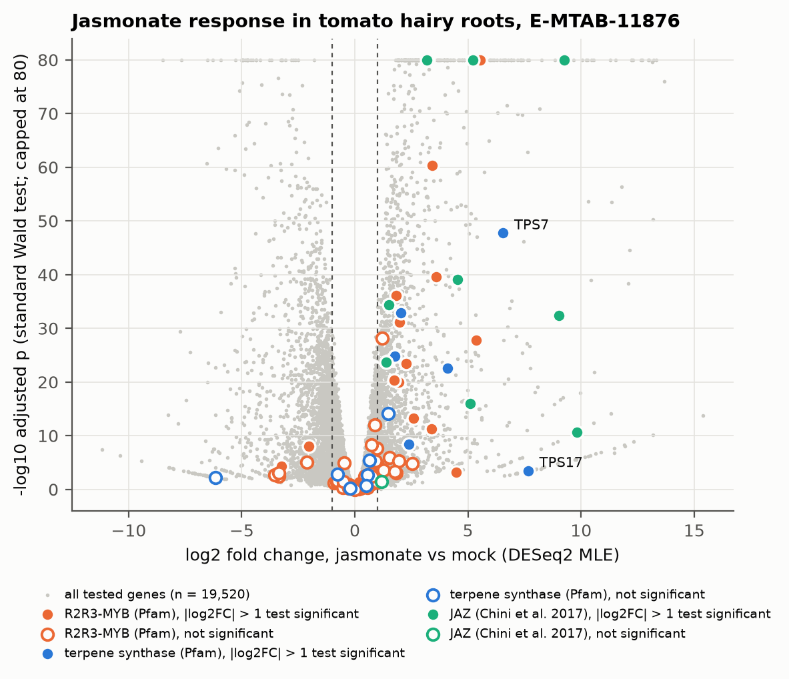
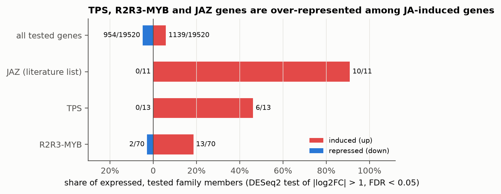
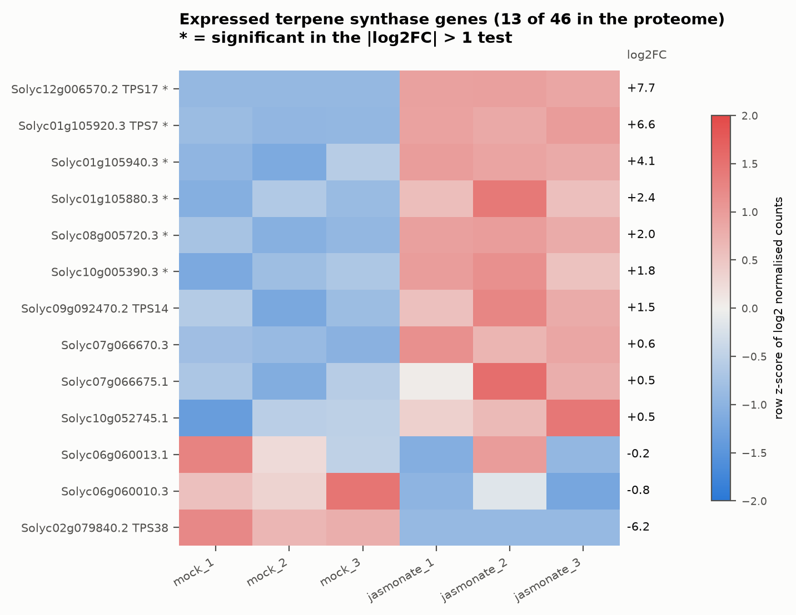
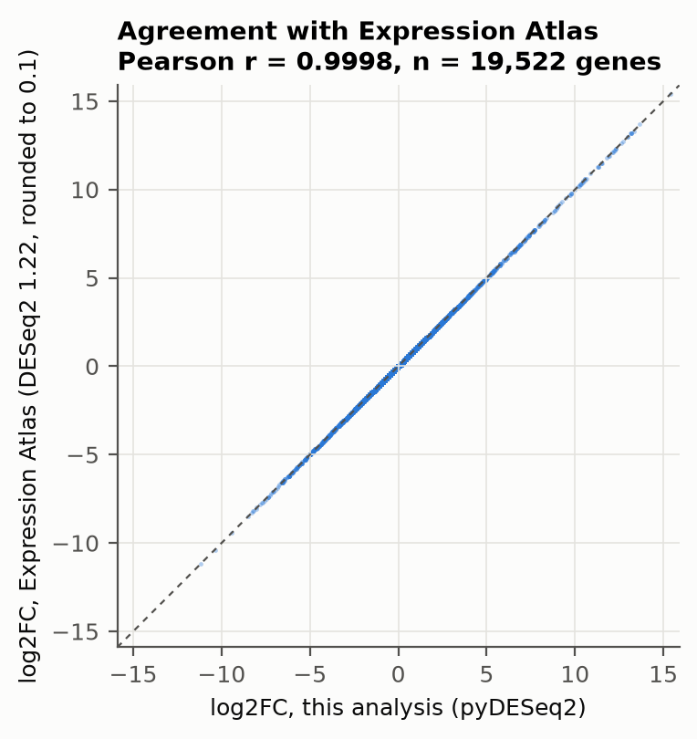

# Case study: which terpene synthase and R2R3-MYB genes respond to jasmonate in tomato hairy roots?

A complete, reproducible re-analysis of a public RNA-seq experiment, from raw
counts to gene-family-level conclusions, with every number in this document
written by `run_case_study.py` into `results/summary.json`.

> **AI assistance.** This analysis, its code, tests and this report were drafted
> with an AI assistant (Claude, Anthropic) working in this repository at the
> author's request, as a worked reference that the author then reviews and
> reproduces independently. The scientific choices are explained below so they
> can be checked rather than trusted. See the repository README for the
> project-wide statement.

## 1. Question and why this dataset

Jasmonate (JA) signalling is a major inducer of terpenoid biosynthesis in many
plants, and R2R3-MYB transcription factors are frequent regulators of
specialised metabolism. The question here is deliberately narrow and testable
with public data:

1. Does a JA treatment produce the expected canonical response (positive
   control)?
2. Which terpene synthase (TPS) and R2R3-MYB genes are expressed and
   JA-responsive in this system, and are these families over-represented among
   JA-induced genes?

**Dataset.** [Expression Atlas / ArrayExpress E-MTAB-11876](https://www.ebi.ac.uk/gxa/experiments/E-MTAB-11876):
tomato (*Solanum lycopersicum* cv. Moneymaker) hairy roots transformed with a
GUS control construct (*Agrobacterium rhizogenes* ATCC 15834), grown two weeks
in liquid MS medium in the dark, then treated with **50 µM JA or mock for 24 h**;
**three biological replicates per group**; Illumina NovaSeq 6000, 100 nt single
end (from the ArrayExpress IDF record).

Why this one: it has true biological replicates (several tomato JA datasets in
GEO do not, or provide only FPKM), Expression Atlas provides uniformly
processed raw counts plus its own DESeq2 analysis to cross-check against, and
hairy roots are a transformation-derived culture system, which is the kind of
cell-based production platform relevant to engineering terpene output.

The ArrayExpress record was submitted by Gryffroy *et al.* (Goossens lab, VIB)
with the title of the RolB study later published as Gryffroy *et al.* 2023,
*PNAS* 120:e2210300120. The published article's main text does not report this
JA-vs-mock experiment; it refers to an in-house JA RNA-seq dataset in its SI.
*That this is the same dataset is an inference*, so this analysis cites the
ArrayExpress record as the primary source.

## 2. Methods (and why each choice was made)

| Step | What | Why |
|---|---|---|
| Inputs | Atlas raw gene counts (iRAP: TopHat2 to Ensembl Plants 53, HTSeq), design XML; Ensembl Plants release 53 tomato proteome; Pfam HMMs from InterPro | One annotation release for counts and proteins, so gene IDs match exactly (34,429 of 34,429 protein-coding genes). SHA-256 of every input is recorded in `results/provenance.json`. |
| Gene set | 34,658 nuclear `Solyc` gene models; 1,167 Ensembl ncRNA features (tRNA, snoRNA, miRNA) dropped | Poly(A) RNA-seq does not measure these meaningfully, and they have no protein for family calls. |
| Expression filter | keep genes with ≥ 10 reads in ≥ 3 samples (19,522 genes) | 3 = smallest group size, so a gene expressed in only one condition survives. Removes genes with no power to be detected. |
| Model | pyDESeq2 0.5.4, design `~condition`, mock as reference, median-of-ratios size factors, parametric dispersion trend, Cook's outlier filtering | Standard negative-binomial GLM for count data with few replicates. Size factors are recomputed independently in `case_study_lib.py` and the run aborts if they disagree with pyDESeq2. |
| Test 1: standard | Wald test, H0: log2FC = 0, BH-adjusted | Feeds the app's exploratory threshold page. |
| Test 2: thresholded | Wald test, H0: \|log2FC\| ≤ 1 (`lfc_null=1`, `greaterAbs`), BH-adjusted | Defines "JA-responsive" in this report. Filtering a standard test by \|log2FC\| > 1 afterwards does **not** control the false discovery rate for that claim; testing against the threshold does. |
| Fold-change shrinkage | apeglm-style prior (`lfc_shrink`), kept as an extra column | For ranking and plotting; low-count genes get shrunk toward 0. |
| Gene families | `hmmsearch` (pyhmmer 0.12.3) of each Pfam HMM at its curated gathering threshold. **TPS**: PF01397 or PF03936. **MYB class**: number of PF00249 repeats on the best isoform (exactly 2 = R2R3-MYB). **JAZ**: tify PF06200 + Jas PF09425 on the same isoform | Reproducible, annotation-version-proof calls instead of hand-copied gene lists. The rules' limits are discussed in section 4. |
| Positive control | the 13 tomato JAZ genes listed by Chini *et al.* 2017 (*PLoS One* 12:e0177381, Table 1) in `reference/chini2017_tomato_jaz.csv` | JAZ genes are the textbook JA-induced genes, so this checks the whole pipeline end to end, and also measures how well the domain rule recovers a literature list. |
| Enrichment | one-sided hypergeometric test of each family's induced members against all tested genes | Asks whether induction in a family exceeds the genome-wide induction rate (5.8%). |
| Cross-check | correlate log2FC and compare calls with Atlas's independent DESeq2 1.22 analysis of the same counts | Detects pipeline bugs (wrong reference level, sample swap, unit errors). |

## 3. Results

### 3.1 The experiment behaves as expected

* Assigned reads per library: 15.7 to 19.6 million. Size factors 0.79 to
  1.27, lower in all three JA libraries.
* PCA of the 500 most variable genes: **PC1 explains 97.0% of variance and
  separates mock from JA completely** (Figure 1). Replicates within a group do
  not separate on PC1.
* **Positive control passes.** Of the 13 literature JAZ genes, 11 pass the
  expression filter and **10 of those 11 are significantly induced**
  (thresholded test; enrichment p = 4.6 × 10⁻¹²). The exceptions are
  informative rather than worrying: SlJAZ13 is barely expressed (mean 12 vs 19
  reads, not significant); SlJAZ10 is induced but below the filter (mean 0 vs
  9.7 reads); SlJAZ12 has zero reads in all six samples
  (`results/positive_control_jaz.csv`).



### 3.2 Global response

* Standard test: 11,387 of 19,520 genes with an adjusted p-value have
  padj < 0.05. With this effect size and replication, "significant at log2FC ≠ 0"
  is most of the transcriptome, which is why it is a poor definition of
  "responsive".
* Thresholded test (\|log2FC\| > 1, FDR < 0.05): **1,139 induced and 954
  repressed genes**.



### 3.3 TPS, R2R3-MYB and JAZ families are over-represented among JA-induced genes

| Family (call) | in proteome | expressed and tested | up | down | p (enriched up) |
|---|---:|---:|---:|---:|---:|
| all tested genes | | 19,520 | 1,139 | 954 | |
| JAZ (literature list) | 13 | 11 | 10 | 0 | 4.6 × 10⁻¹² |
| TPS (Pfam) | 46 | 13 | 6 | 0 | 4.7 × 10⁻⁵ |
| R2R3-MYB (Pfam) | 127 | 70 | 13 | 2 | 1.8 × 10⁻⁴ |
| 1R-MYB / MYB-related (Pfam) | 137 | 91 | 4 | 0 | 0.78 |

All three hypotheses survive a Bonferroni correction across the four families
tested. Note that the hypergeometric test treats genes as independent, which
tandem gene clusters violate (see 3.4), so these p-values are optimistic.



### 3.4 Terpene synthases

46 proteins carry a TPS domain (Falara *et al.* 2011, *Plant Physiol*
157:770, reported 44 TPS gene models on an earlier assembly; the difference is
expected from a newer annotation and from partial models, which the evidence
column flags). Only **13 are expressed** in hairy roots, and **6 are
JA-induced; none is repressed** (Figure 4):

| Gene | Atlas name | mean normalised count | log2FC | padj (\|log2FC\| > 1 test) |
|---|---|---:|---:|---:|
| Solyc12g006570.2 | TPS17 | 15 | +7.7 | 9.1 × 10⁻³ |
| Solyc01g105920.3 | TPS7 | 171 | +6.6 | 1.5 × 10⁻³⁴ |
| Solyc01g105940.3 | | 1,019 | +4.1 | 3.5 × 10⁻¹³ |
| Solyc01g105880.3 | | 52 | +2.4 | 4.1 × 10⁻³ |
| Solyc08g005720.3 | | 236 | +2.0 | 7.6 × 10⁻⁹ |
| Solyc10g005390.3 | | 1,455 | +1.8 | 5.4 × 10⁻⁵ |

Observations and the limits of each:

* **Three of the six induced TPS genes sit side by side on chromosome 1**
  (Solyc01g105880, 105920 = TPS7, 105940). Falara *et al.* place TPS7 in the
  chromosome 1 TPS-b cluster, so the two unnamed neighbours are *probably*
  members of that cluster (inference from position; verify names against the
  Falara supplementary table).
* TPS17 has the largest fold change but a very low baseline (mean 15 reads);
  its shrunk fold change is similar, but the absolute expression is small.
* TPS14 (log2FC +1.5) is significant in the standard test but not in the
  thresholded test (padj 0.075): a real but modest induction that this report
  does not count as "responsive". This is the thresholded test working as
  intended.
* TPS38 shows log2FC −6.2 but is not significant (mean 8 reads).
* **Expression is not activity.** Nothing here shows more terpene product;
  that needs GC-MS on the same material.



### 3.5 R2R3-MYB transcription factors

127 proteins have exactly two MYB repeats; 70 are expressed; **13 are induced
and 2 repressed**. The most strongly induced are Solyc06g083900 (+5.5),
Solyc03g119370 (+5.4), Solyc02g089190 (+3.6), Solyc01g057910 (+3.4) and
Solyc05g053330 (+3.4) (full list: `results/deseq2_jasmonate_vs_mock.csv`,
filter `family == "R2R3-MYB"`).

These are **candidates, not regulators of TPS**. Co-induction with TPS genes
is compatible with a regulatory link but equally with independent JA targets.
Testing a link needs, at minimum, promoter transactivation assays and
loss- or gain-of-function lines.

### 3.6 Agreement with the independent Expression Atlas analysis

Same counts, different software (pyDESeq2 0.5.4 here, DESeq2 1.22.1 in Atlas),
different gene filtering:

* log2 fold changes: **Pearson r = 0.9998**, Spearman ρ = 0.9992 across all
  19,522 genes (Figure 5; Atlas rounds to 0.1).
* Genes called with padj < 0.05 and \|log2FC\| ≥ 1 (a post hoc filter, used here
  only because it is what can be applied identically to both tables): 4,685
  here, 4,934 in Atlas, 4,628 shared (**Jaccard 0.93**). The small
  difference is consistent with Atlas testing all genes rather than the
  filtered set, which changes the multiple-testing burden.
* Atlas's column is labelled `p-value`, so whether it is adjusted was
  checked rather than assumed: on a log10 scale it sits much closer to this
  analysis's `padj` (median absolute difference 0.10) than to its raw
  `pvalue` (0.37), and is ≥ the raw p-value for 97.2% of 19,498 genes. It is
  therefore treated as adjusted (`results/summary.json`,
  `atlas_pvalue_scale_check`).

This post hoc count (4,685) is larger than the thresholded-test count (2,093)
because the thresholded test asks the harder question (is the effect *larger
than* 2-fold?) rather than (is there an effect, and does its point estimate
exceed 2-fold?).



## 4. Limitations

* **One time point, one tissue, one genotype background.** Hairy roots at
  24 h; transcript changes in aerial tissues or glandular trichomes (where
  most tomato terpenes are made) may differ.
* **Domain rules are not curated orthology.**
  * The JAZ rule recovers 12 of 13 literature JAZ genes (misses the divergent
    SlJAZ12) and adds 5 tify+Jas proteins not in that list
    (Solyc01g106030, Solyc01g106040, Solyc04g076527, Solyc06g084120,
    Solyc10g047640). None of the 5 is JA-responsive, consistent with their
    being other TIFY subfamilies; this is not resolved here.
  * "Exactly two MYB repeats" also captures CDC5-like proteins (e.g.
    Solyc04g009950, `cdc5`), which are not canonical R2R3-MYB transcription
    factors.
  * Solyc12g099120 carries six MYB repeats arranged as three R2R3 pairs, most
    likely three tandem R2R3-MYB genes merged into one gene model
    (inference); it is reported separately as "6R-MYB" (induced, +2.5).
* **Two genes have no p-value** (Solyc11g039980, Solyc11g056320): DESeq2's
  Cook's-distance filter flagged a single extreme sample (jasmonate_1, e.g.
  500 reads vs 49 and 27 in the other JA replicates). With three replicates
  DESeq2 does not replace outliers, so NA is the correct result, not a bug.
* **19 genes have padj = 0**, which is floating-point underflow for extremely
  strong responses, not an exact zero.
* **Annotation version.** Ensembl Plants 53 (assembly SL3.0 in the file name);
  gene versions (`.1`, `.2`, `.3`) are kept exactly. Literature IDs are matched
  on the unversioned locus and the code refuses ambiguous matches.

## 5. Reproduce it

```bash
python3.13 -m venv .venv-analysis && . .venv-analysis/bin/activate
python -m pip install -r analysis/tomato_ja_hairy_roots/requirements.txt
python analysis/tomato_ja_hairy_roots/run_case_study.py     # ~1-2 min, downloads ~12 MB
python -m pytest tests/test_case_study_lib.py tests/test_case_study.py
```

Re-running reproduces every output byte for byte (checked), except the
timestamp in `results/provenance.json`. If Expression Atlas re-processes the
experiment, the recorded SHA-256 of the raw counts will no longer match;
compare against `results/provenance.json` before trusting a rerun.

## 6. Files

| Path | Content |
|---|---|
| `run_case_study.py` | orchestration: download, annotate, model, cross-check, write |
| `case_study_lib.py` | pure, unit-tested helpers (numpy/pandas only) |
| `figures.py` | report figures |
| `reference/chini2017_tomato_jaz.csv` | literature positive-control list with source |
| `results/deseq2_jasmonate_vs_mock.csv` | full DESeq2 output, both tests, shrunk LFC, family labels |
| `results/gene_families.csv`, `pfam_domain_hits.csv` | family calls and the underlying domain hits |
| `results/family_response_summary.csv`, `positive_control_jaz.csv` | tables in section 3 |
| `results/summary.json`, `provenance.json` | every number in this report; inputs, checksums, versions, parameters |
| `../../data/case_studies/tomato_ja_hairy_roots/` | app-ready tables (log2 normalised expression, metadata, DE results, gene-annotation CSV) |

To explore the results interactively: run the app, choose **Upload Data →
Real case study**, then on **Gene Expression** upload
`data/case_studies/tomato_ja_hairy_roots/gene_annotation.csv` to see family
labels next to gene IDs.

## 7. Redo it yourself: checkpoints

If you re-implement this from scratch (recommended), these are the values to
hit and the questions to be able to answer:

1. Load counts and design; confirm which three runs are JA. *Why does the
   reference level matter for the sign of log2FC?*
2. Filter to 19,522 genes. *What happens to the number of tested genes and to
   padj if you skip the filter?*
3. Size factors 0.79 to 1.27. *Why are they all lower in the JA samples, and
   is that a problem?*
4. PCA, PC1 ≈ 97%. *Would you trust the DE results if a JA sample clustered
   with mock?*
5. Positive control: 10 of 11 tested JAZ induced. *Write this check before
   looking at TPS.*
6. Thresholded test: 1,139 up / 954 down. *Explain in two sentences why this
   differs from filtering the standard test.*
7. Family calls: TPS 46, R2R3-MYB 127, JAZ 17. *Find one call you disagree
   with and justify it.*
8. Cross-check vs Atlas: r ≈ 0.9998. *What bug would produce r ≈ −1?*
9. Name the unnamed induced TPS genes using Falara *et al.* 2011 and say which
   enzymatic products are known for them.

## References

* Chini A, Ben-Romdhane W, Hassairi A, Aboul-Soud MAM (2017) Identification of
  TIFY/JAZ family genes in *Solanum lycopersicum* and their regulation in
  response to abiotic stresses. *PLoS One* 12:e0177381.
  doi:10.1371/journal.pone.0177381
* Falara V, *et al.* (2011) The tomato terpene synthase gene family.
  *Plant Physiol* 157:770–789. doi:10.1104/pp.111.179648
* Gryffroy L, *et al.* (2023) Rhizogenic *Agrobacterium* protein RolB
  interacts with the TOPLESS repressor proteins to reprogram plant immunity
  and development. *Proc Natl Acad Sci USA* 120:e2210300120.
  doi:10.1073/pnas.2210300120
* Love MI, Huber W, Anders S (2014) Moderated estimation of fold change and
  dispersion for RNA-seq data with DESeq2. *Genome Biol* 15:550.
  doi:10.1186/s13059-014-0550-8
* Muzellec B, Teleńczuk M, Cabeli V, Andreux M (2023) PyDESeq2: a python
  package for bulk RNA-seq differential expression analysis.
  *Bioinformatics* 39:btad547. doi:10.1093/bioinformatics/btad547
* Expression Atlas: E-MTAB-11876.
  https://www.ebi.ac.uk/gxa/experiments/E-MTAB-11876
